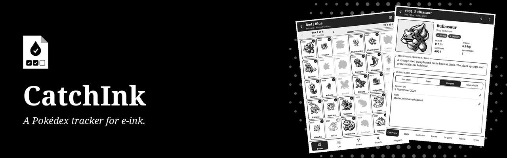
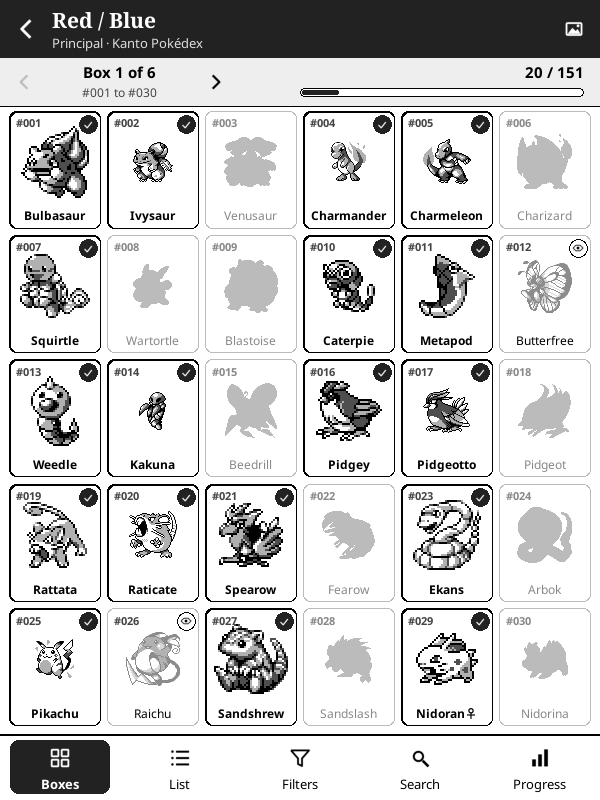
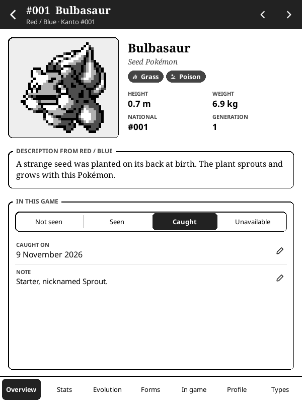
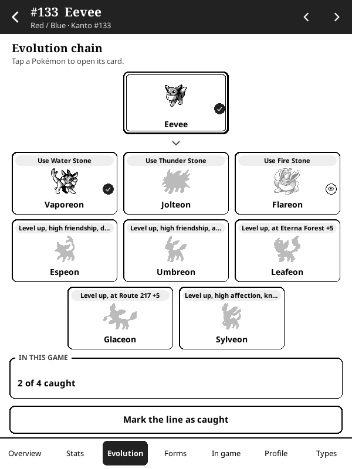
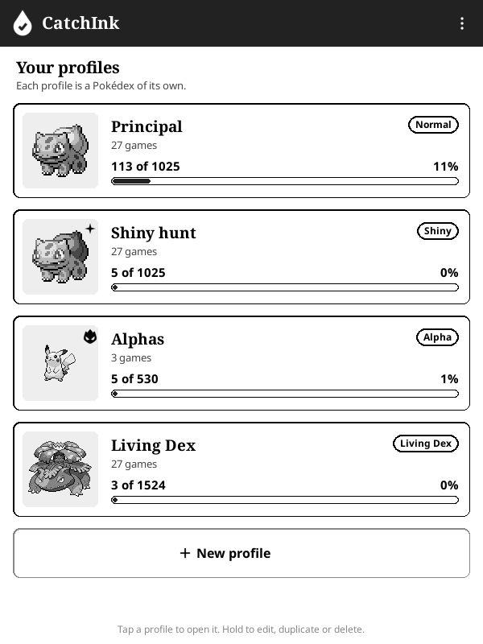

<p align="center">
  
</p>

<p align="center">
  <strong>A Pokédex tracker for KOReader, made for e-ink. In Portuguese, English and Spanish.</strong>
</p>

<p align="center">
  <a href="https://github.com/beater-studios/catchink.koplugin/releases/latest"></a>
  <a href="https://github.com/beater-studios/catchink.koplugin/actions/workflows/ci.yml"></a>
  <a href="https://koreader.rocks"></a>
  
  <a href="LICENSE"></a>
</p>

<p align="center">
  <a href="#what-it-does">What it does</a> ·
  <a href="#installation">Installation</a> ·
  <a href="#how-to-use">How to use</a> ·
  <a href="#development">Development</a> ·
  <a href="README_pt.md">Leia em português</a>
</p>

## What it does

<table>
  <tr>
    <td width="25%" align="center"><br><sub><b>Boxes like in the games</b></sub></td>
    <td width="25%" align="center"><br><sub><b>A card for each Pokémon</b></sub></td>
    <td width="25%" align="center"><br><sub><b>Evolutions with conditions</b></sub></td>
    <td width="25%" align="center"><br><sub><b>Several Pokédex at once</b></sub></td>
  </tr>
</table>

Mark the Pokémon you caught in each game, on a screen that sits next to the console for hours without glare.

- **27 games**, from Red / Blue to Legends: Z-A, each with its regional Pokédex (the three of Kalos together; Isle of Armor, Crown Tundra, Teal Mask, Indigo Disk and Mega Dimension under their game).
- **Forms in each game:** a profile that counts forms lists the ones each game has (Alolan Vulpix in Sun / Moon and Sword / Shield, Unown letters in Gold / Silver, Hisuian forms in Legends: Arceus), never the battle-only ones.
- **The national view** joins every game of a profile. Catches with no game (in HOME, for instance) are marked there.
- **Profiles:** as many Pokédex as you want, from a model: normal, shiny, alpha (the Legends games), Living Dex (forms and genders) or your own choice of sprites, gender mode, forms and games.
- **Boxes of 30 and a list:** a tap marks or clears, with undo; a hold opens the card. Missing Pokémon show as silhouettes. Seen and unavailable (shiny locked, event only) are marked too, and unavailable ones leave the total.
- **Filters and search:** generation, up to two types, caught, missing, seen or unavailable, legendary, mythical, baby or with forms, by name or number, ordered by regional number, national number or name.
- **The card,** in seven pages: overview (sprite, genus, types, size, the game's Pokédex text, status, catch date and a note), stats (base stats, abilities, catching and breeding, gender), evolution (the chain with each condition, and marking the whole line), forms (normal and shiny), in the game (where to find it and level-up moves) in the profile (which games already have it) and types (what it is weak to and resists, and what its moves do, in the type chart of the game's generation).
- **Type chart:** the full chart of each generation (the 1st, the 2nd to the 5th, the 6th onwards), with the summary of each type, and an icon for every type wherever a type shows.
- **Progress** by generation and by game, with the last 7 days.
- **Sprites:** three packages bring the base set, the base set with shiny, or no sprites; each game's own sprites (box icons from Sun / Moon on) are downloaded on the device. A game without its set uses the base and says so once per visit.
- **Three languages:** Portuguese, English and Spanish. Moves, abilities and places keep their official English names in Portuguese.
- **Its own sleep screen:** when the device sleeps with CatchInk open and KOReader's sleep screen shows the book cover, it shows CatchInk's cover instead.

## Installation

1. Download one of the three packages from the [latest release](https://github.com/beater-studios/catchink.koplugin/releases/latest). They differ only in the sprites that come inside:

   | Package | Sprites inside | Size |
   |---|---|---|
   | `catchink.koplugin.zip` (recommended) | the base set | about 4.2 MB |
   | `catchink.koplugin-shiny.zip` | the base set, normal and shiny | about 6.2 MB |
   | `catchink.koplugin-nosprites.zip` | none, every set is downloaded on the device | about 1.9 MB |

2. Unzip it into the `plugins` folder of KOReader, so you get `koreader/plugins/catchink.koplugin/`.
3. Restart KOReader. The plugin is in **Tools > CatchInk**.
4. To use each game's own sprites, or the sets your package does not bring, open **Sprites** in the menu of the home screen and download them over Wi-Fi.

The checksum of each package is in its `.sha256` file. Profiles live in `koreader/settings/catchink.lua`, the catches of each profile in `koreader/settings/catchink_profile_<id>.lua`, sprites in `koreader/catchink/sprites/`. To uninstall, delete `koreader/plugins/catchink.koplugin/`, the `catchink*.lua` files of `koreader/settings/` and the folder `koreader/catchink/`.

## How to use

1. **Create a profile:** pick a model, then change the name, sprites (normal or shiny), the gender mode, forms and games if you want. A new profile can start with the catches of another.
2. **Open a game** from the profile's list, or the national Pokédex on top. Swipe or use the arrows to change boxes.
3. **Tap** a Pokémon to mark it caught, tap again to clear it. "Undo" stays at the bottom for a few seconds.
4. **Hold** it to open its card. On the overview, set it as not seen, seen, caught or unavailable, change the catch date and write a note. Swipe to the next one.
5. **Filters, search and progress** are in the bottom bar. Tap a filter chip to remove it.
6. **Sprites:** the picture button at the top of a game chooses its set. The Sprites screen downloads, resumes and deletes sets. Downloads run while the plugin is open, and the device stays awake meanwhile.

## Compatibility

- Made for KOReader 2026.07 and for touchscreens, always in portrait. It was developed for a 10th generation basic Kindle (firmware 5.18.1).
- Layout checked in the emulator at 600x800, 758x1024, 1072x1448 and 1264x1680.
- Uses only what comes with KOReader, with nothing else to install. The data comes inside the plugin, so only sprite downloads need Wi-Fi.

## Development

With [LuaJIT](https://luajit.org) installed, from the repository root, the same checks as the CI:

```sh
sh tools/check.sh           # tests, texts, the hand-written data and the three packages
sh tools/check.sh release   # also downloads the data sources at fixed commits and builds data/ again, as the release does
```

With the official KOReader for desktop, `KOREADER_DIR` pointing at the folder with `luajit` and `reader.lua`:

```sh
tools/koreader/run_emulator.sh                                    # opens KOReader with the plugin, 600 x 800
tools/koreader/check_all_sizes.sh                                 # every view in four screen sizes
tools/koreader/run_headless.sh tools/koreader/fuzz_ui.lua         # random touches through every view
```

The other checks (`check_screensaver.lua`, `check_rotation.lua`, `check_sleep.lua`, `check_awake.lua`, `check_https.lua` and `check_download.lua`) run the same way and are listed in [docs/design.md](docs/design.md#tests-and-tools).

The data comes from `tools/build_data.py`, with the sources from `tools/fetch_sources.sh`. The images in `assets/` come from `tools/make_assets.py`, the README screenshots from `tools/koreader/readme_screens.sh` and the banner, the icon and the social preview from `tools/make_brand_art.py` (Pillow). How the code is organized and why is in [docs/design.md](docs/design.md). Contributions are accepted under the project's license.

## Credits

Data: [PokeAPI](https://pokeapi.co/), [PKHeX](https://github.com/kwsch/PKHeX) for the encounters of the newer games and the forms of each game, and [Serebii.net](https://www.serebii.net/pokearth/sinnoh/) for the encounter chances of Brilliant Diamond and Shining Pearl. Sprites: [PokeAPI/sprites](https://github.com/PokeAPI/sprites) (the base set comes with the plugin, the others are downloaded to your device). Type icons: [partywhale/pokemon-type-icons](https://github.com/partywhale/pokemon-type-icons) (MIT). Portuguese texts translated by Beater Studios.

## License

The code is under [GPL-3.0](LICENSE), version 3 only. You may use, study, modify and redistribute it, keeping it open under the same license. This license grants no rights to the names "CatchInk" and "Beater Studios". See [NOTICE](NOTICE).

Pokémon and all related names are trademarks of Nintendo, Creatures Inc. and GAME FREAK inc., and the sprites are © The Pokémon Company. CatchInk is an unofficial, fan-made project, not endorsed by, sponsored by or affiliated with those companies.

---

<p align="center">
  <sub>Made by <a href="https://beaterstudios.com/">Beater Studios</a></sub>
</p>
