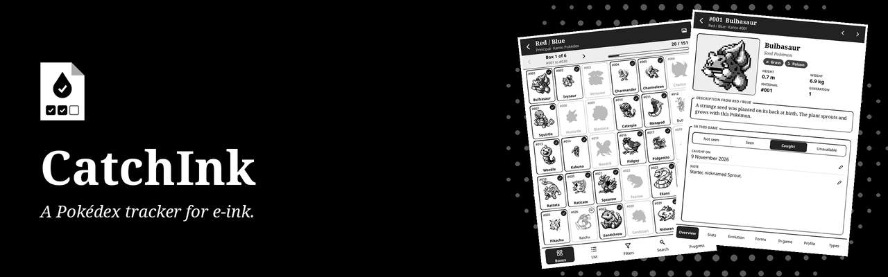
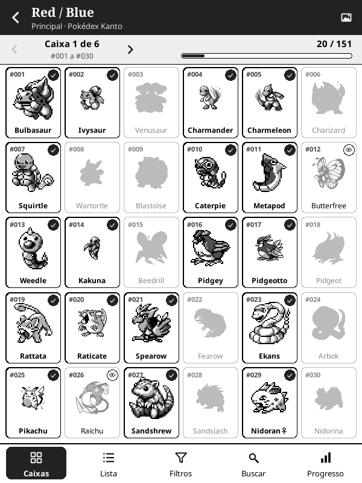
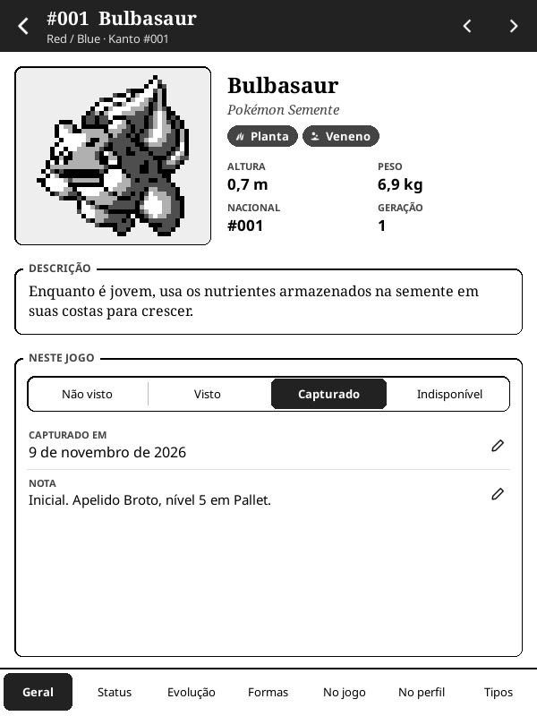
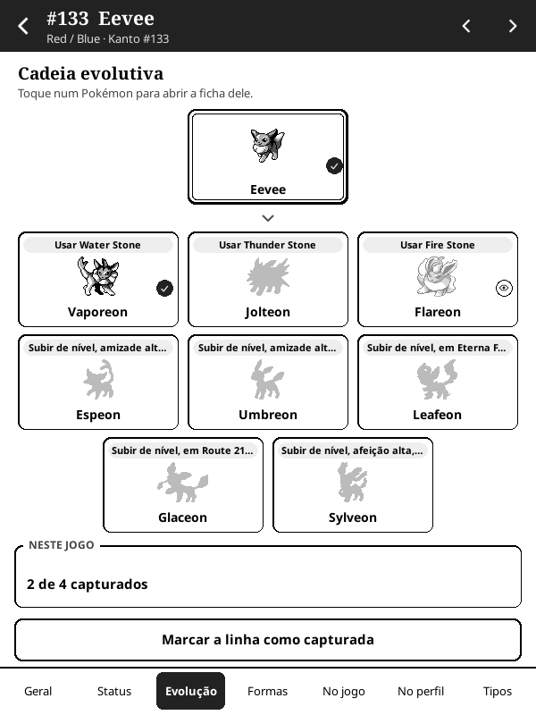
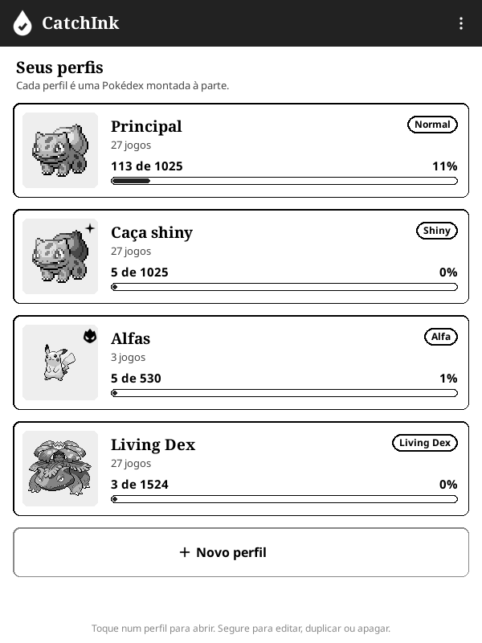

<p align="center">
  
</p>

<p align="center">
  <strong>Um registrador de Pokédex no KOReader, feito para e-ink. Em português, inglês e espanhol.</strong>
</p>

<p align="center">
  <a href="https://github.com/beater-studios/catchink.koplugin/releases/latest"></a>
  <a href="https://github.com/beater-studios/catchink.koplugin/actions/workflows/ci.yml"></a>
  <a href="https://koreader.rocks"></a>
  
  <a href="LICENSE"></a>
</p>

<p align="center">
  <a href="#o-que-faz">O que faz</a> ·
  <a href="#instalação">Instalação</a> ·
  <a href="#como-usar">Como usar</a> ·
  <a href="#desenvolvimento">Desenvolvimento</a> ·
  <a href="README.md">Read in English</a>
</p>

## O que faz

<table>
  <tr>
    <td width="25%" align="center"><br><sub><b>Caixas como nos jogos</b></sub></td>
    <td width="25%" align="center"><br><sub><b>Uma ficha para cada Pokémon</b></sub></td>
    <td width="25%" align="center"><br><sub><b>Evoluções com condições</b></sub></td>
    <td width="25%" align="center"><br><sub><b>Várias Pokédex ao mesmo tempo</b></sub></td>
  </tr>
</table>

Marque os Pokémon que você pegou em cada jogo, numa tela que fica horas ao lado do console sem reflexo.

- **27 jogos**, de Red / Blue a Legends: Z-A, cada um com a sua Pokédex regional (as três de Kalos juntas; Isle of Armor, Crown Tundra, Teal Mask, Indigo Disk e Mega Dimension embaixo do jogo).
- **Formas em cada jogo:** um perfil que conta formas mostra as que cada jogo tem (Vulpix de Alola em Sun / Moon e Sword / Shield, as letras de Unown em Gold / Silver, as formas de Hisui em Legends: Arceus), nunca as que só existem em batalha.
- **A nacional** junta todos os jogos de um perfil. Capturas sem jogo (no HOME, por exemplo) são marcadas nela.
- **Perfis:** quantas Pokédex você quiser, a partir de um modelo: normal, shiny, alfa (os Legends), Living Dex (formas e gêneros) ou do seu jeito, escolhendo sprites, modo de gênero, formas e jogos.
- **Caixas de 30 e lista:** um toque marca ou desmarca, com desfazer; segurar abre a ficha. O que falta aparece como silhueta. Também dá para marcar visto e indisponível (shiny bloqueado, só de evento), e os indisponíveis saem do total.
- **Filtros e busca:** geração, até dois tipos, capturados, faltando, vistos ou indisponíveis, lendário, mítico, bebê ou com formas, por nome ou número, em ordem de número regional, nacional ou nome.
- **A ficha,** em sete páginas: geral (sprite, categoria, tipos, tamanho, a descrição do jogo, situação, data da captura e nota), status (status base, habilidades, captura e criação, gênero), evolução (a cadeia com cada condição e marcar a linha inteira), formas (normal e shiny), no jogo (onde encontrar e golpes por nível) no perfil (em quais jogos você já tem) e tipos (a que ele é fraco e o que resiste, e o que os golpes dele fazem, na tabela da geração do jogo).
- **Tabela de tipos:** a tabela completa de cada geração (a 1ª, da 2ª à 5ª, da 6ª em diante), com o resumo de cada tipo, e um ícone para cada tipo em todo lugar onde aparece um tipo.
- **Progresso** por geração e por jogo, com os últimos 7 dias.
- **Sprites:** três pacotes trazem o conjunto base, o base com shiny ou nenhuma sprite; as sprites de cada jogo (ícones de caixa de Sun / Moon em diante) são baixadas no aparelho. Um jogo sem o seu conjunto usa o base e avisa uma vez por visita.
- **Três idiomas:** português, inglês e espanhol. Golpes, habilidades e lugares ficam com os nomes oficiais em inglês na interface em português.
- **Tela de descanso própria:** quando o aparelho dorme com o CatchInk aberto e a tela de descanso do KOReader mostra a capa do livro, aparece a capa do CatchInk no lugar.

## Instalação

1. Baixe um dos três pacotes da [última versão](https://github.com/beater-studios/catchink.koplugin/releases/latest). Eles só mudam nas sprites que vêm dentro:

   | Pacote | Sprites dentro | Tamanho |
   |---|---|---|
   | `catchink.koplugin.zip` (recomendado) | o conjunto base | cerca de 4,2 MB |
   | `catchink.koplugin-shiny.zip` | o conjunto base, normal e shiny | cerca de 6,2 MB |
   | `catchink.koplugin-nosprites.zip` | nenhuma, todos os conjuntos são baixados no aparelho | cerca de 1,9 MB |

2. Descompacte na pasta `plugins` do KOReader, para ficar `koreader/plugins/catchink.koplugin/`.
3. Reinicie o KOReader. O plugin fica em **Ferramentas > CatchInk**.
4. Para usar as sprites de cada jogo, ou os conjuntos que o seu pacote não traz, abra **Sprites** no menu da tela inicial e baixe pelo Wi-Fi.

A soma de verificação de cada pacote está no arquivo `.sha256` dele. Os perfis ficam em `koreader/settings/catchink.lua`, as capturas de cada perfil em `koreader/settings/catchink_profile_<id>.lua` e as sprites em `koreader/catchink/sprites/`. Para desinstalar, apague `koreader/plugins/catchink.koplugin/`, os arquivos `catchink*.lua` de `koreader/settings/` e a pasta `koreader/catchink/`.

## Como usar

1. **Crie um perfil:** escolha um modelo e, se quiser, mude o nome, as sprites (normais ou shiny), o modo de gênero, as formas e os jogos. Um perfil novo pode começar com as capturas de outro.
2. **Abra um jogo** na lista do perfil, ou a Pokédex nacional no alto. Arraste ou use as setas para trocar de caixa.
3. **Toque** num Pokémon para marcar como capturado e toque de novo para desmarcar. O "Desfazer" fica embaixo por alguns segundos.
4. **Segure** para abrir a ficha. Na página geral, marque como não visto, visto, capturado ou indisponível, mude a data da captura e escreva uma nota. Arraste para ir ao próximo.
5. **Filtros, busca e progresso** ficam na barra de baixo. Toque num filtro do alto para tirar.
6. **Sprites:** o botão de imagem no alto de um jogo escolhe o conjunto dele. A tela Sprites baixa, continua e apaga conjuntos. Os downloads correm com o plugin aberto, e o aparelho fica acordado enquanto isso.

## Compatibilidade

- Feito para o KOReader 2026.07 e para telas de toque, sempre em retrato. Foi desenvolvido para um Kindle básico de 10ª geração (firmware 5.18.1).
- Layout conferido no emulador em 600x800, 758x1024, 1072x1448 e 1264x1680.
- Usa só o que vem com o KOReader, sem nada para instalar à parte. Os dados vêm dentro do plugin, então só o download das sprites precisa de Wi-Fi.

## Desenvolvimento

Com o [LuaJIT](https://luajit.org) instalado, da raiz do repositório, as mesmas conferências da CI:

```sh
sh tools/check.sh           # testes, textos, os dados escritos à mão e os três pacotes
sh tools/check.sh release   # também baixa as fontes dos dados em commits fixos e gera data/ de novo, como a release
```

As verificações no KOReader de computador, as ferramentas que geram os dados e as imagens e a organização do código estão no [README em inglês](README.md#development) e em [docs/design.md](docs/design.md). Contribuições são aceitas sob a licença do projeto.

## Créditos

Dados: [PokeAPI](https://pokeapi.co/), [PKHeX](https://github.com/kwsch/PKHeX) para os encontros dos jogos mais novos e as formas de cada jogo, e [Serebii.net](https://www.serebii.net/pokearth/sinnoh/) para as chances de encontro de Brilliant Diamond e Shining Pearl. Sprites: [PokeAPI/sprites](https://github.com/PokeAPI/sprites) (o conjunto base vem no plugin, os outros são baixados no seu aparelho). Ícones dos tipos: [partywhale/pokemon-type-icons](https://github.com/partywhale/pokemon-type-icons) (MIT). Textos em português traduzidos pela Beater Studios.

## Licença

O código está sob a [GPL-3.0](LICENSE), somente a versão 3. Você pode usar, estudar, modificar e redistribuir, mantendo-o aberto sob a mesma licença. Esta licença não dá direito aos nomes "CatchInk" e "Beater Studios". Veja o [NOTICE](NOTICE).

Pokémon e os nomes relacionados são marcas da Nintendo, Creatures Inc. e GAME FREAK inc., e as sprites são © The Pokémon Company. O CatchInk é um projeto não oficial, feito por fãs, sem endosso, patrocínio ou ligação com essas empresas.

---

<p align="center">
  <sub>Feito pela <a href="https://beaterstudios.com/">Beater Studios</a></sub>
</p>
